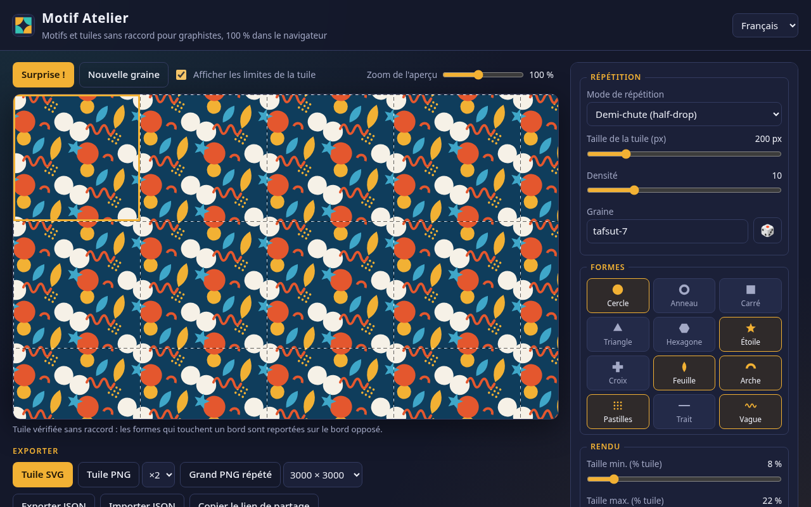
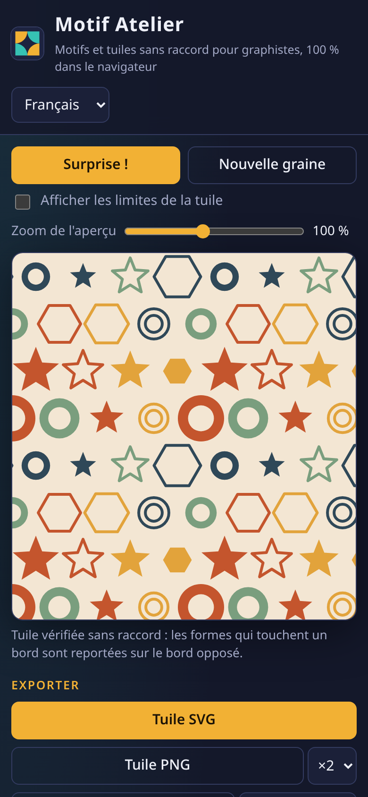

# Motif Atelier

Générateur de **motifs répétables sans raccord** (tuiles / *seamless patterns*) pour graphistes : textile, packaging, papier peint, fonds web, réseaux sociaux.  
Tout tourne dans le navigateur : rien n’est envoyé sur un serveur, pas de compte, pas de clé d’API.

**Démo :** [https://salimadour31-boop.github.io/motif-atelier/](https://salimadour31-boop.github.io/motif-atelier/)





---

## C’est quoi ?

Tu choisis des formes (cercles, feuilles, étoiles, vagues…), un mode de répétition, une palette — et Motif Atelier compose une **tuile carrée parfaitement raccordable**. L’aperçu montre la tuile répétée sur toute la surface, avec en option le tracé des limites de tuile.

Le raccord est garanti par construction : chaque forme qui déborde d’un bord est **reportée sur le bord opposé** (dans l’aperçu, dans le PNG *et* dans le SVG). Les tests automatisés vérifient que la tuile est périodique au pixel près.

## Fonctionnalités

- **12 formes procédurales** : cercle, anneau, carré, triangle, hexagone, étoile, croix, feuille, arche, pastilles, trait, vague
- **7 modes de répétition** : grille simple, demi-chute (*half-drop*), brique, miroir, rotation × 4, réseau hexagonal, semis aléatoire
- Réglages : taille de tuile (64–800 px), densité, plage de tailles, rotation de base, variation de rotation, plein / contour / mélange, épaisseur de contour
- Palette : fond + 3 à 5 couleurs éditables, **12 palettes intégrées** (Kasbah, Méditerranée, Djurdjura, Sahara, Henné…), palette harmonieuse au hasard
- **Graine** reproductible (même graine = même motif) + bouton « nouvelle graine » 🎲 et bouton « Surprise ! »
- Aperçu répété en direct, zoom 25–200 %, limites de tuile en option
- Exports :
  - **Tuile SVG** vectorielle sans raccord (ouvrable dans Illustrator, Inkscape, Figma…)
  - **Tuile PNG** ×1 / ×2 / ×4
  - **Grand PNG répété** : 1920×1080, 2560×1440, 3840×2160, 3000×3000, 1080×1080, 1080×1920 ou format personnalisé (jusqu’à 8000 px)
  - **Fond CSS** prêt à copier (SVG en *data URI*)
  - **JSON** des réglages (export / import)
- Réglages mémorisés (localStorage) + **lien de partage** (`#s=…`)
- Interface **FR / EN / Taqbaylit** (kabyle), responsive desktop / mobile, libellés accessibles
- 100 % HTML / CSS / JS — pas de build, pas de framework, aucune dépendance externe

## Utilisation

1. Ouvre la [démo](https://salimadour31-boop.github.io/motif-atelier/) ou `index.html` en local.
2. Choisis un mode de répétition et coche les formes voulues.
3. Ajuste densité, tailles, rotation, rendu ; choisis une palette ou clique sur « Palette au hasard ».
4. Change la graine 🎲 jusqu’à trouver la composition idéale.
5. Exporte : SVG pour le vectoriel, PNG pour les maquettes, CSS pour le web.

Astuce Illustrator : importe la tuile SVG puis glisse-la dans le panneau *Nuancier* pour obtenir une nuance de motif répétable.

## Structure

```
motif-atelier/
  index.html
  styles.css
  motif.js     ← moteur : placement, symétries, rendu canvas + SVG sans raccord
  app.js       ← interface, exports, mémorisation, lien de partage
  i18n.js      ← traductions FR / EN / Taqbaylit
  tests/e2e.js ← tests Playwright (rendu, langues, exports, raccord)
  captures/
```

## Tests

```bash
python3 -m http.server 8765 &
npm i playwright-core && npx playwright-core install chromium
node tests/e2e.js
```

Le script vérifie (desktop 1280×800 et mobile 390×844) : absence d’erreurs console, les 3 langues, les 7 modes × 3 rendus, la périodicité exacte de la tuile, la continuité des bords, le SVG (analyse XML + rendu identique au canvas), les PNG, le CSS, le JSON, le lien de partage et la mémorisation.

## Licence

MIT — © 2026 Amirouche Amwanes / [salimadour31-boop](https://github.com/salimadour31-boop)

Les traductions en taqbaylit sont un premier jet : corrections bienvenues via *pull request*.

---

## English (short)

**Motif Atelier** is a free, browser-only **seamless repeating pattern generator** for designers. Pick procedural shapes (circles, leaves, stars, waves, hexagons…), a repeat mode (grid, half-drop, brick, mirror, 4-way rotation, hex lattice, random scatter), sizes, rotation jitter, fill/stroke and a palette (12 built-in palettes or random), then re-roll the seed until you love it. Shapes crossing an edge are wrapped onto the opposite edge, so the tile is truly seamless. Export a vector **SVG tile**, a **PNG tile** (×1/×2/×4), a **large repeated PNG** (1920×1080, 3000×3000, 4K, custom…), a **CSS background** data URI, or **JSON** settings. Settings persist locally and can be shared via URL. UI in French, English and Taqbaylit (Kabyle). No uploads, no dependencies, MIT licensed.
